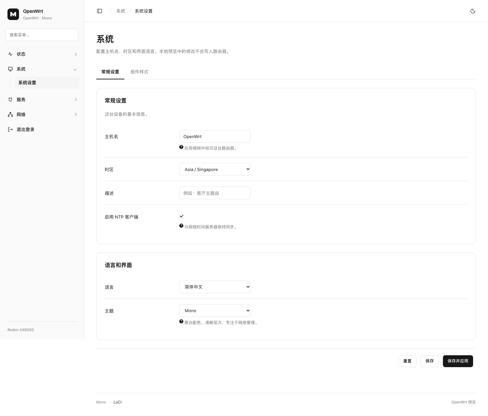

# Mono for LuCI

[](https://github.com/wizcheu/luci-theme-mono/actions/workflows/build.yml)

以 shadcn/ui 的 neutral dashboard 为视觉参考，为 OpenWrt 原生 LuCI 开发的黑白极简主题。

白色主界面、浅灰侧栏、细边框、黑色主按钮、自然留白。支持本地浅色 / 深色切换、可收起侧栏、菜单搜索和手机抽屉导航。运行时仅使用 LuCI、CSS 和原生 JavaScript，无 React、外部字体或 CDN 请求。



## 兼容范围

- 针对 **ucode 模板版 LuCI**，包括当前 Redmi AX6000 使用的 coolsnowwolf/LEDE LuCI `0a19762`。
- IPK 为 `all` 架构包；安装器会检查 `/usr/share/ucode/luci/runtime.uc`，拒绝纯 Lua 旧版 LuCI。
- 不根据固件的版本名称推断兼容性；不同分支迁移 ucode 的时间不同。
- 保留 LuCI 原生页面、ACL 菜单、保存 / 应用、回滚、RPC、认证与 CSRF 流程。主题不改写网络设置，不替换任何插件页面。
- OpenClash 的 LuCI 配置页使用主题的通用控件样式；独立的 Zashboard 面板使用自己的界面。带有独立 CSS 的第三方插件可能覆盖部分主题样式。
- 直接构建脚本输出 **opkg IPK**。使用 APK 的固件请将本仓库加入对应 OpenWrt SDK / 源码树，由其原生打包工具构建。

## 本地预览

```sh
npm run preview
# 或 python3 scripts/mirror.py --port 8101
```

打开 <http://127.0.0.1:8101>。已迁入 Aeris 的 **50 个脱敏原生 LuCI 页面**，包括网络、无线、DHCP、DNS、防火墙、系统、日志、软件包和 OpenClash；另有组件规范与登录页。

- 主界面采用 shadcn/ui Neutral 的语义变量、36px 控件、32px 小号按钮、6px 控件圆角、10px 卡片圆角和灰底标签页。
- 支持深浅色切换、菜单搜索、`⌘K` / `Ctrl+K` 聚焦搜索和移动端抽屉。
- 可编辑原生表单、打开接口弹窗、模拟保存与应用。底部「重置示例」恢复全部样本。
- 系统与设备数据来自已脱敏的快照。概览流量采用 Aeris 的演示曲线，标记为示例流量；不是实机实时状态。
- 预览只监听 `127.0.0.1`，所有写操作仅作用于进程内存，不连接路由器。

生产主题仍使用原生 LuCI / ucode。shadcn/ui 的设计规范通过 CSS 和原生控件适配实现，没有引入 React 运行时。样式、控件与概览渲染器和 IPK 共用，`preview/`、模拟后端及上游快照不会进入安装包。

详细说明和修改入口见 [预览开发说明](docs/preview-development.md)。旧设计样板可用 `npm run preview:legacy` 在 8102 端口打开。

## 构建安装包

Python 3.10+ 即可，不需要 OpenWrt SDK 或交叉编译器：

```sh
python3 scripts/build.py
```

输出到 `dist/`：

- `luci-theme-mono_1.0.2-1_all.ipk`
- `SHA256SUMS`
- `manifest.json`：包哈希及每个安装文件的哈希

包使用 OpenWrt opkg 的 gzip / tar 格式，固定文件顺序、时间和所有者；同一份源码可重复得到相同制品。可通过 `SOURCE_DATE_EPOCH` 指定归档时间。

## 安装与启用

将 IPK 上传至路由器 `/tmp/`，然后执行：

```sh
opkg install /tmp/luci-theme-mono_1.0.2-1_all.ipk
```

安装只注册主题，保持当前主题选择。进入 **系统 → 系统 → 语言和界面 → 主题 → Mono**，保存并应用，再刷新页面。

也可以通过 SSH 切换；先记下当前主题，便于恢复：

```sh
uci get luci.main.mediaurlbase
uci set luci.main.mediaurlbase='/luci-static/mono'
uci commit luci
```

界面异常时，通过 SSH 恢复先前记录的路径。例如已安装 Argon 的这台 AX6000：

```sh
uci set luci.main.mediaurlbase='/luci-static/argon'
uci commit luci
```

刷新浏览器即可，无需重启路由器。卸载用 `opkg remove luci-theme-mono`；若 Mono 正在使用，卸载脚本会清除它的选择，由 LuCI 从其余已注册且可用的主题中回退。请保留至少一个其他可用主题。

## 加入固件源码

在已经更新并安装 feeds 的 OpenWrt / LEDE 源码根目录：

```sh
git clone https://github.com/wizcheu/luci-theme-mono.git package/luci-theme-mono
make menuconfig
# LuCI → Themes → luci-theme-mono
make package/luci-theme-mono/compile V=s
```

`Makefile` 通过 `feeds/luci/luci.mk` 集成。默认只加入固件，不更改主题选择；若要作为新固件的默认主题，在自己的固件 defaults 脚本中设置 `luci.main.mediaurlbase`。

## GitHub 与制品

项目仓库：[wizcheu/luci-theme-mono](https://github.com/wizcheu/luci-theme-mono)。推送 `main` 即可触发 [Build Mono theme](https://github.com/wizcheu/luci-theme-mono/actions/workflows/build.yml)。

- 普通 push / PR / 手动触发：模板检查、安装包测试、桌面与手机浏览器测试，上传 IPK、源码包、校验和及预览截图到 Actions Artifacts。
- 推送 `v*` 标签：全部检查通过后自动创建 GitHub Release 并上传制品。
- 发布前更新 `Makefile` 中 `PKG_VERSION` / `PKG_RELEASE`，并同步 `package.json` 的版本。同步更新 `package-lock.json` 和 `docs/release-notes.md`。

首次发布示例：

```sh
git push -u origin main
git tag v1.0.2
git push origin v1.0.2
```

## 开发与验证

```sh
python3 -m unittest discover -s tests -p 'test_*.py' -v
npm ci
npx playwright install chromium
npm test
```

本机已有 Chrome 时也可以运行 `MONO_CHROME_CHANNEL=chrome npm test`。浏览器测试涵盖桌面与手机页面溢出、菜单过滤与恢复、浅深模式持久化、侧栏键盘操作、表单演示、弹窗及登录错误状态。

修改 ucode 模板或预览 HTML 后，使用安装了 fs 模块的 ucode 重新生成预览：

```sh
ucode -L "$PWD/preview/stubs" scripts/render-preview.uc
```

GitHub Actions 从固定的官方 ucode 提交构建校验器，并确认生成的预览已同步。预览 stubs 仅替代服务器的 board / core 数据，**不会安装到路由器**。

验证记录见 [docs/validation.md](docs/validation.md)。已在 Redmi AX6000 上安装并验证实际登录页及系统设置的日志、时间同步标签；README 顶部截图来自本地演示页面。插件页面和设置提交行为仍待进一步验收。

## 目录

```text
htdocs/luci-static/mono/              设计变量、组件样式、侧栏和外观行为
htdocs/luci-static/resources/         LuCI 菜单模块
ucode/template/themes/mono/           页头、页尾、登录模板
root/etc/uci-defaults/                主题注册
scripts/                             独立 IPK 构建、预览服务与模板渲染
preview/                             可交互的本地演示
tests/                               安装包与浏览器测试
.github/workflows/build.yml           检查、制品与标签发布
```

## 许可与参考

Apache-2.0，详见 [LICENSE](LICENSE) 和 [NOTICE](NOTICE)。

- 视觉参考：[shadcn/ui dashboard](https://ui.shadcn.com/view/new-york-v4/dashboard-01)
- 原生兼容样式与模板约定：[LuCI Bootstrap](https://github.com/coolsnowwolf/luci/tree/0a19762/themes/luci-theme-bootstrap)

`compat.css` 保留上游原始许可，最终视觉规范集中在 `shadcn.css`，便于后续更新上游控件支持。
